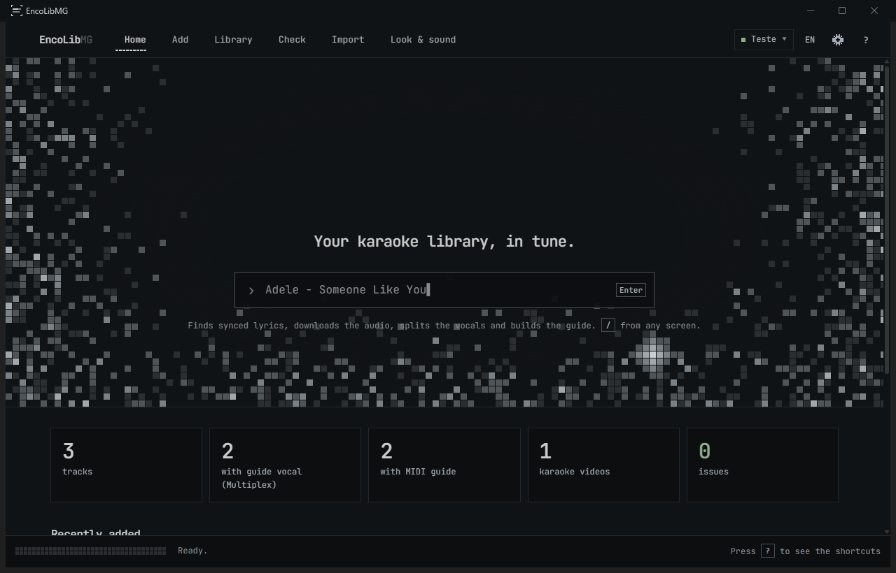

<p align="center"></p>

<p align="center"><b>Your karaoke library, in tune.</b><br>
Builds and organizes an <code>EncoreLibrary</code> for
<a href="https://github.com/Encore-Karaoke-Labs/Encore-Karaoke">Encore Karaoke</a>, using everything the player can do.</p>

<p align="center"><b>English</b> · <a href="README.pt-BR.md">Português (Brasil)</a></p>



## What every song gets

| File | What it does in Encore |
|---|---|
| `Artist - Song.multiplexed.mp3` | Instrumental on the left channel, vocals on the right. ◀/▶ turns the guide vocal on and off. |
| `Artist - Song.lrc` | Synced lyrics, in the exact format Encore reads. Japanese and Korean are romanized automatically. |
| `Artist - Song.guide.mid` | **MIDI guide**: the melody notes (detected with CREPE) and word-by-word lyrics. Pitch guide, scoring and lyric highlighting become accurate. In Encore, `M` → Guide plays the melody. |
| `Artist - Song.mp4` (optional) | The official music video playing muted behind the lyrics, without losing the guide vocal. |

When there are no synced lyrics, EncoLibMG downloads a **karaoke video (MTV)** instead. Every track ends up
at the same loudness (−16 LUFS), without squashing the dynamics.

## Install
1. You need **Python 3.12** and **ffmpeg** (`winget install Gyan.FFmpeg`). Windows 10/11 already ships
   WebView2, which draws the window.
2. Double-click `instalar.bat`. It's ~3 GB because of PyTorch, Demucs and the models.
   With an NVIDIA card, everything runs on the GPU.

## Use
1. Double-click `Abrir EncoLibMG.bat`.
2. At the top, click the library name → **Open or create** (or `Ctrl O`). If the folder isn't a library yet,
   the app creates the `EncoreLibrary` folder with its `manifest.json`.
3. On **Home**, type `Artist - Song` and press `Enter`.
4. Pick a lyrics version marked ✓ and click **Download full**. The app looks for audio with the same length as
   the lyrics, splits the vocals, builds the Multiplex and generates the MIDI guide.
5. In Encore, point Setup (F2) at the library folder. Encore also finds any folder named `EncoreLibrary`
   on your drives by itself.

The app follows the Windows language (English or Brazilian Portuguese). Switch any time with the
**EN/PT** button at the top; no restart needed.

## Screens

**Home**: the pixel logo, the search box and your library's numbers.

**Add**: lyrics results, with the 5 steps lighting up while the song is prepared.
For MTV videos and music videos there's a picker with YouTube thumbnails.

**Library**: filters (Multiplex, with guide, no guide, MTV, MIDI, hidden), multi-select and a panel per track.
From the panel you can listen to instrumental/vocals/both, open Sync and the guide preview, build the guide,
edit, add a music video, convert to Multiplex or remove.


**Sync**: the vocal waveform in pixels, with every lyric line marked on it. Drag the waveform to scrub.
- **Shift everything:** ±1 s or ±0.1 s.
- **Anchors:** while the song plays, press `Space` when the selected line starts being sung.
  With two or more, the lyrics are stretched between them.
- **Suggest:** finds where the vocals start on its own.
- There's always a backup, with **Undo**. When you save, the app offers to rebuild the guide.

**Guide preview**: a piano roll with the notes Encore will use and the lyrics lighting up word by word,
just like in Encore.

**Check**: finds what Encore would ignore or show wrong and fixes it in one click. It covers:
- audio without lyrics;
- tracks without a MIDI guide;
- non-standard lyrics;
- unsupported formats (FLAC, WMA, MOV…);
- files in subfolders;
- an incomplete manifest;
- missing tags;
- volume (optional).


**Import**: brings in what you already have: CDs/FLAC, CDG collections, `.zip` files and `.kar`/`.mid`
karaoke (the title is read from inside the file, Japanese included). Before importing, you review the names in
an editable preview. The app can build the Multiplex **from your own file**, at your source's quality.

**Look & sound**:
- **Background videos** by category, from your PC or YouTube. From YouTube, only a clip of up to 5 minutes.
- **Idle images** for the screen between songs.
- The library's **intro video**.
- **Score narration**: one audio clip per score range.
- **SoundFont**: includes a download of the free GeneralUser GS.

**Settings** (⚙ at the top): the library's name, description and Encore options.

### Shortcuts
| Key | Action |
|---|---|
| `/` | Search for a song |
| `1`–`6` | Home, Add, Library, Check, Import, Look & sound |
| `Space` | Play/pause · in Sync: set an anchor |
| `←` `→` | Back/forward 5 s |
| `Esc` | Close a dialog or panel, or go back |
| `Ctrl O` | Open or create a library |
| `?` | All shortcuts |

Nothing is really deleted: whatever is removed goes to the Recycle Bin, and every edited lyric gets a backup.

## Identity
The **"Sung line"** mark: a karaoke line halfway through filling up, between corner brackets. The look is
inspired by [Omarchy](https://omarchy.org/), with an original design. Everything (mark, wordmark, Windows icon)
is generated from pixel grids by [scripts/brand.py](scripts/brand.py). The identity page is
[docs/brand/index.html](docs/brand/index.html).

## Development
```
.venv\Scripts\python -m pytest            # fast tests (includes the JS ones when Node is installed)
.venv\Scripts\python -m pytest -m slow    # also runs the real Demucs and CREPE
.venv\Scripts\python -m pytest -m ui      # opens the real window and runs the main flows
.venv\Scripts\python -m encolibmg --debug # opens the window with the developer tools
```
- **Layout:** Python engine in `encolibmg/`; interface in `encolibmg/webui/` (pywebview + lit-html, no build
  step); pixel effects in `encolibmg/webui/static/js/fx/`.
- **Translations:** every text lives in `scripts/catalog_engine.py` (engine) and `scripts/catalog_ui.py`
  (interface) as `(key, pt-BR, en)`. Run `python scripts/i18n_build.py` to regenerate `encolibmg/locales/`.
  The tests fail if a key is missing, unused, or a language lacks a `{placeholder}`.
- **Screenshots of the real window:** `ENCOLIB_TEST_LIB=<library> ENCOLIB_LANG=en python scripts/snap_app.py <folder> home library …`.
- **Docs:** [roadmap](docs/roadmap.md) · [interface spec](docs/specs/2026-10-26-nova-ui-design.md).
- **Log:** `%APPDATA%\EncoLibMG\log.txt`.

## License
EncoLibMG is free software under the [GPL-3.0](LICENSE). Third-party licenses are listed in
[THIRD_PARTY_NOTICES.md](THIRD_PARTY_NOTICES.md). Note: the MMS alignment model (Meta), downloaded the first
time a guide is built, is **CC BY-NC 4.0**, for non-commercial use only.

For personal use. You are responsible for the content you download.
