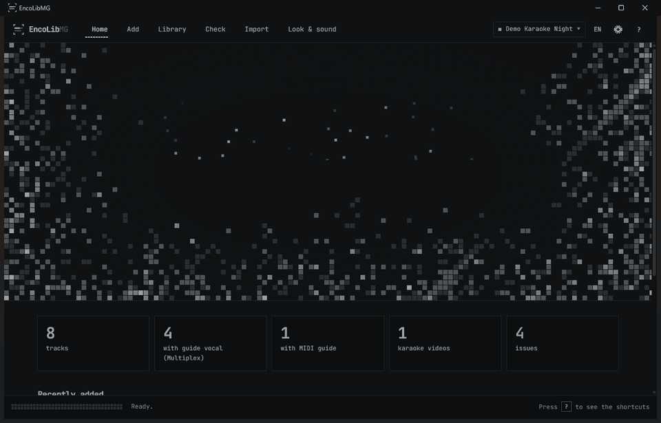
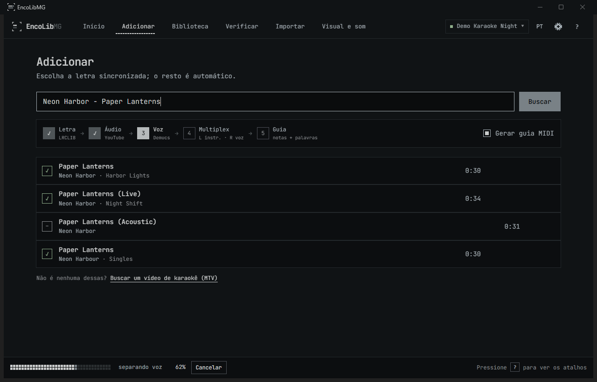
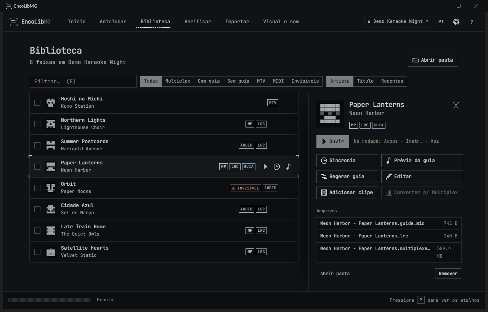
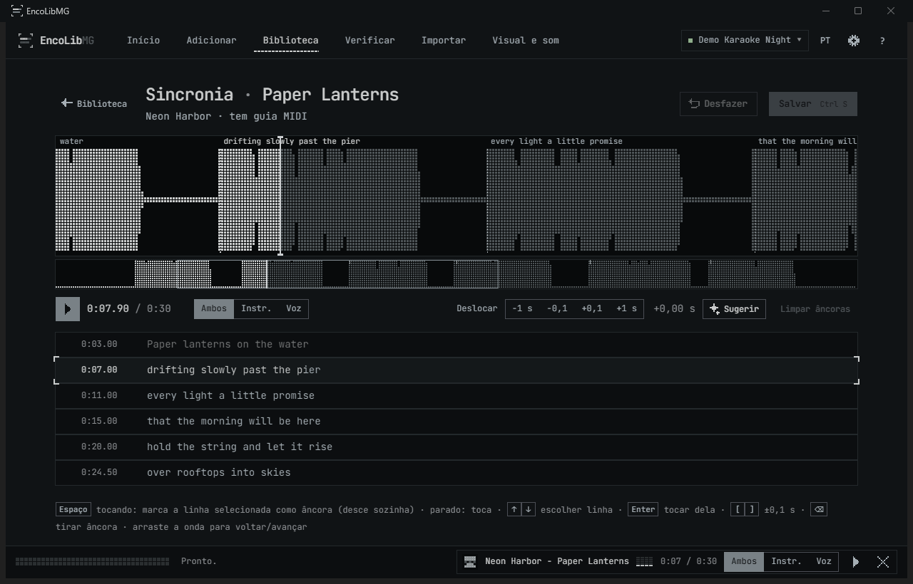
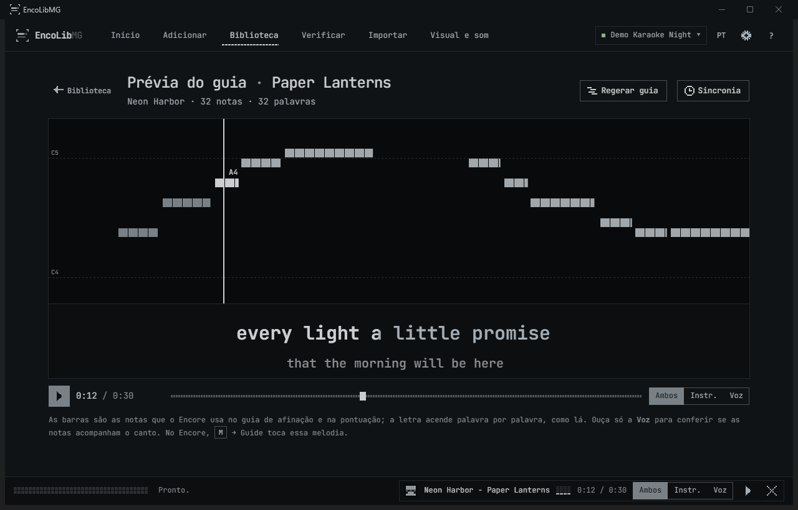
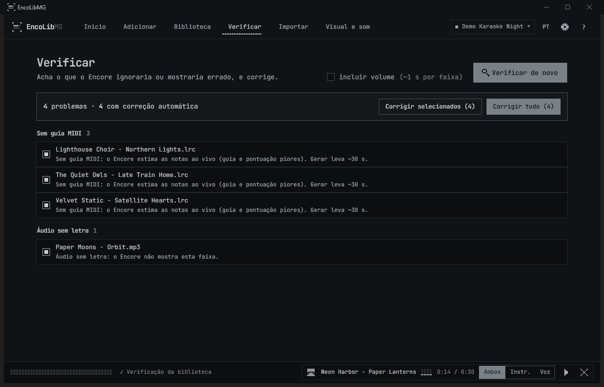
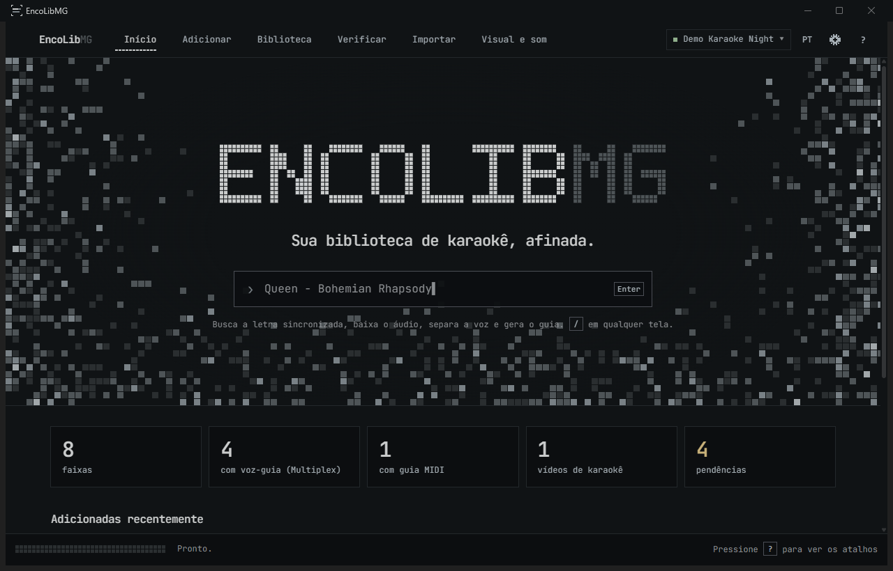

<b>Sua biblioteca de karaokê, afinada.</b> 
Digite o nome de uma música. Receba uma faixa de karaokê completa para o
<a href="https://github.com/Encore-Karaoke-Labs/Encore-Karaoke">Encore Karaoke</a>: letra sincronizada, voz-guia que
liga e desliga e um guia de afinação MIDI com a letra palavra a palavra.

  
  
  
  
  

<a href="../README.md">English</a> · <b>Português (Brasil)</b>

## O que cada música ganha

| Arquivo | O que faz no Encore |
|---|---|
| `Artista - Música.multiplexed.mp3` | Instrumental à esquerda e voz à direita: **◀/▶ liga e desliga a voz-guia**. A voz é separada com o Demucs na sua GPU. |
| `Artista - Música.lrc` | **Letra sincronizada** no formato exato que o Encore lê, casada com o áudio pela duração. Japonês e coreano ganham romanização. |
| `Artista - Música.guide.mid` | **Guia MIDI**: as notas reais da melodia (CREPE) e a letra palavra a palavra (MMS), para guia de afinação, pontuação e realce precisos. |
| `Artista - Música.mp4` *(opcional)* | O clipe tocando mudo atrás da letra, sem perder a voz-guia. |

Não existe letra sincronizada? Ele baixa um **vídeo de karaokê** no lugar. Todas as faixas saem com o mesmo volume.

## Hardware: o que você precisa e o que esperar

A parte pesada de cada música é separar a voz (Demucs) e gerar o guia MIDI (CREPE + MMS). Isso roda na **placa de
vídeo NVIDIA** quando existe uma, e no processador quando não. Todo o resto (Biblioteca, Sincronia, Verificar,
Importar, Visual e som) é leve e roda bem em qualquer PC.

**Medido** numa música de 4 minutos com o [`scripts/benchmark.py`](../scripts/benchmark.py) (baixar o áudio soma um
pouco, conforme a sua internet):

| PC | Tempo por música | Pico de memória |
|---|---|---|
| NVIDIA **RTX 5070 Ti** (16 GB) · Ryzen 5 7600X · 32 GB de RAM | **menos de 1 minuto** (0,8 min) | 3,4 GB de memória de vídeo · ~4 GB de RAM |
| O mesmo PC **sem a placa de vídeo** (só o processador) | **11 a 12 minutos** | ~12 GB de RAM, ao gerar o guia |

| | Mínimo | Recomendado |
|---|---|---|
| **Sistema** | Windows 10 ou 11, 64 bits | Windows 11 |
| **Placa de vídeo** | nenhuma: tudo roda no processador | NVIDIA GeForce **série GTX 10 ou mais nova** (de preferência RTX) com **6 GB ou mais** de memória de vídeo |
| **RAM** | 8 GB com placa NVIDIA · 16 GB sem | 16 GB ou mais |
| **Processador** | qualquer um de 64 bits | 6 núcleos ou mais se não houver placa NVIDIA |
| **Disco** | ~10 GB para o app e os modelos de IA, mais as suas músicas | um SSD |
| **Internet** | para buscar e baixar músicas | |

**O que esperar**
- **Placa NVIDIA recente (RTX):** uma música fica pronta em cerca de um minuto; dá para adicionar uma atrás da outra.
- **Placa NVIDIA mais antiga ou de entrada** (GTX 10/16, RTX 2060/3050…): funciona igual, só que mais devagar.
  Ainda não medimos essas placas: rode `python scripts/benchmark.py` e compartilhe seus números numa
  [issue](https://github.com/pdromguel/encolibmg/issues).
- **Sem placa NVIDIA** (vídeo AMD ou Intel, a maioria dos notebooks): tudo funciona, no processador. Conte com 10
  minutos ou mais por música num processador moderno de 6 núcleos, mais com menos núcleos ou modelos antigos.
  Dica: desligue **Gerar guia MIDI** ao adicionar e depois selecione várias músicas na Biblioteca para gerar os
  guias de uma vez, por exemplo durante a noite. Gerar guias assim usa ~12 GB de RAM, então com 8 GB pode faltar
  memória.
- **Placas de vídeo AMD e Intel** não são usadas: as bibliotecas de IA precisam do CUDA da NVIDIA.
- **NVIDIA série GTX 900 ou mais antiga:** o PyTorch atual não tem mais suporte. O app detecta isso e usa o
  processador.
- **Primeira música:** os modelos de IA (1,6 GB) são baixados uma vez, então a primeira música demora alguns
  minutos a mais.

## Telas

<table>
  <tr>
    <td width="50%"> <b>Adicionar</b>: escolha a letra, o resto é automático.</td>
    <td width="50%"> <b>Biblioteca</b>: filtros, seleção múltipla e um painel por faixa.</td>
  </tr>
  <tr>
    <td> <b>Sincronia</b>: acerte o tempo da letra sobre a onda da voz.</td>
    <td> <b>Prévia do guia</b>: as notas e a letra palavra a palavra que o Encore vai usar.</td>
  </tr>
  <tr>
    <td> <b>Verificar</b>: acha o que o Encore ignoraria e corrige com um clique.</td>
    <td> <b>E mais</b>: fila de downloads para listas inteiras (colar, playlist do YouTube, CSV do Spotify); importa CDs, pacotes CDG e .kar; vídeos de fundo, abertura, narração da nota, SoundFont.</td>
  </tr>
</table>

Os prints usam uma biblioteca de demonstração com músicas inventadas, gerada por <a href="../scripts/screenshots/demo_library.py">scripts/screenshots/demo_library.py</a>.

## Começo rápido

1. Instale o **Python 3.12** e o **ffmpeg** (`winget install Gyan.FFmpeg`). O Windows 10/11 já traz o WebView2.
2. Baixe a [versão mais recente](https://github.com/pdromguel/encolibmg/releases/latest) (ou clone o repositório) e
   dê dois cliques em **`install.bat`**. Ele baixa o PyTorch e escolhe a versão certa para o seu PC (a versão para
   NVIDIA ocupa ~8 GB instalada); veja [Hardware](#hardware-o-que-você-precisa-e-o-que-esperar).
3. Dê dois cliques em **`EncoLibMG.bat`**, abra ou crie uma biblioteca e busque uma música.

Depois aponte o Setup (F2) do Encore para a pasta da biblioteca. O app fala português do Brasil e inglês
(segue o Windows; troque quando quiser no **PT/EN**).

## Saiba mais

- [Guia de uso](user-guide.pt-BR.md): cada tela, atalhos, dicas.
- [O que o Encore lê](encore-format.md) (em inglês): os formatos de arquivo em que o app se baseia.
- [Roadmap](roadmap.md) (em inglês): fila de downloads, mais fontes de letra, editor do guia, instalador.
- [Arquitetura](architecture.md) e [como contribuir](../.github/CONTRIBUTING.md) (em inglês): para desenvolvedores.
- [Changelog](../CHANGELOG.md).

## Licença

Software livre sob a [GPL-3.0](../LICENSE). As licenças de terceiros estão em
[THIRD_PARTY_NOTICES.md](../THIRD_PARTY_NOTICES.md). Atenção: o modelo de alinhamento MMS (Meta), baixado na primeira
geração de guia, é **CC BY-NC 4.0**, só para uso não comercial.

**Aviso.** O EncoLibMG organiza a **sua biblioteca pessoal de karaokê**. Ele não hospeda nem distribui músicas,
letras ou vídeos. Baixar conteúdo protegido por direitos autorais pode não ser permitido onde você mora ou pelos
termos dos sites envolvidos: o que você baixa e como usa é responsabilidade sua. O EncoLibMG não tem vínculo com o
Encore Karaoke, o LRCLIB ou o YouTube.
