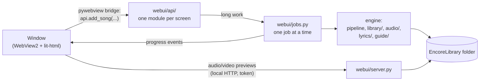

# Architecture

EncoLibMG is a Python program with a web interface in a native window. The Python side does the work (download,
vocal separation, lyrics, MIDI guides, files on disk); the window only shows it and sends clicks back.



## Folders

```
encolibmg/
├── __main__.py        starts the window (python -m encolibmg)
├── pipeline.py        "add a song": lyrics → audio → vocals → Multiplex → guide
├── youtube.py         search and download with yt-dlp
├── core/              basics every part uses
│   ├── paths.py       config, log and backup folders (%APPDATA%\EncoLibMG)
│   ├── i18n.py        translations; texts live in core/locales/*.json
│   ├── errors.py      Cancelled, AlreadyExists, NoAudioMatch
│   └── files.py       safe file names, downloads with progress
├── library/           everything that reads or writes the EncoreLibrary folder
│   ├── model.py       Library and Track: how files group into tracks and what kind each is
│   ├── manifest.py    manifest.json (title, Encore options, background videos…)
│   ├── tags.py        artist/title tags in the audio files
│   ├── checker.py     the Check screen: find problems and fix them
│   ├── importer.py    the Import screen: CDs, CDG, .zip, .kar
│   ├── midi_info.py   reads names and lyrics inside .kar/.mid files
│   ├── visual.py      background videos, idle images, intro video, score narrations
│   └── soundfont.py   the library's SoundFont
├── audio/             ffmpeg and Demucs: convert, decode, loudness, Multiplex, vocal separation
├── lyrics/            LRCLIB search, choosing the right version, LRC cleanup, timing (sync)
├── guide/             the MIDI guide: melody (CREPE), word alignment (MMS), romanization, MIDI file
└── webui/             the interface
    ├── app.py         creates the window
    ├── server.py      local HTTP server: the page and /media (only files inside the library)
    ├── jobs.py        runs long work in the background and reports progress
    ├── serialize.py   turns engine objects into plain dicts for the page
    ├── api/           methods the page calls, one module per screen (library, add, sync, check, …)
    └── static/        the page: index.html, css/, js/ (app, store, views/ = screens, ui/ = dialogs and
                       toasts, fx/ = pixel effects), vendor/ (lit-html), fonts/, brand/
scripts/
├── i18n/              the translation tables (strings_engine.py, strings_ui.py) and build.py
├── brand/             logo, icons and the identity page, generated from pixel grids
└── screenshots/       screenshots of the real window (for the README)
tests/                 fast tests; -m slow (real models/network); -m ui (real window); js/ (Node)
docs/                  this file, the Encore file format, roadmap, screenshots, brand page, history/
```

## Rules of thumb

- **The engine never talks to the window.** It takes `on_progress(key, fraction)` and `cancel` and raises
  errors with translated messages. `webui/` is the only place that knows about the page.
- **Texts are keys.** Progress steps (`step.download`), errors (`err.no_lrc`) and labels are translated where they
  are shown. Add new texts to `scripts/i18n/` and run `python scripts/i18n/build.py`.
- **Nothing is deleted for good.** Removed files go to the Recycle Bin; edited lyrics and guides get a backup.
- **Files stay inside the library.** Paths that come from the page go through `library.inside()`.
- **Long work is a job.** One at a time, cancellable, with progress in the footer.
