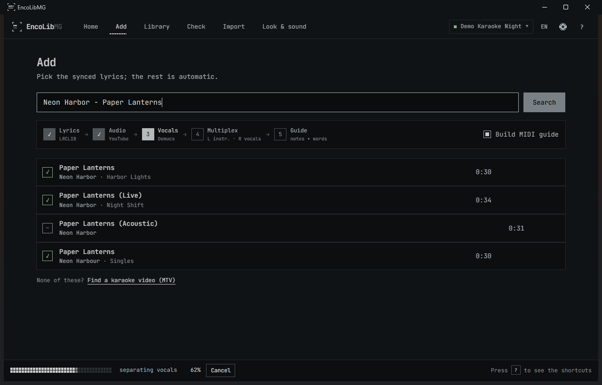
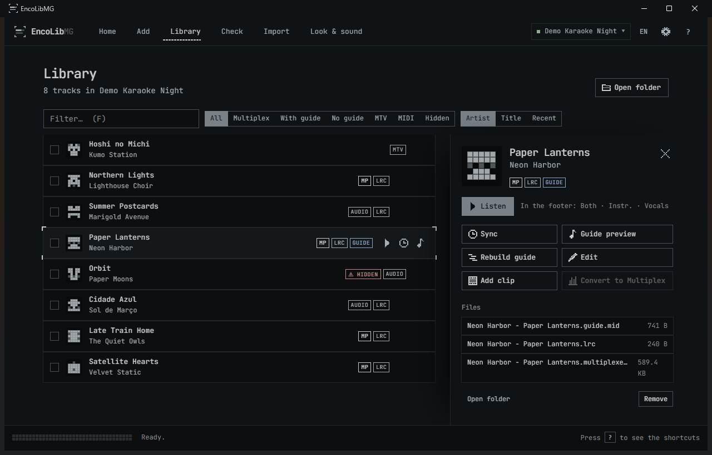
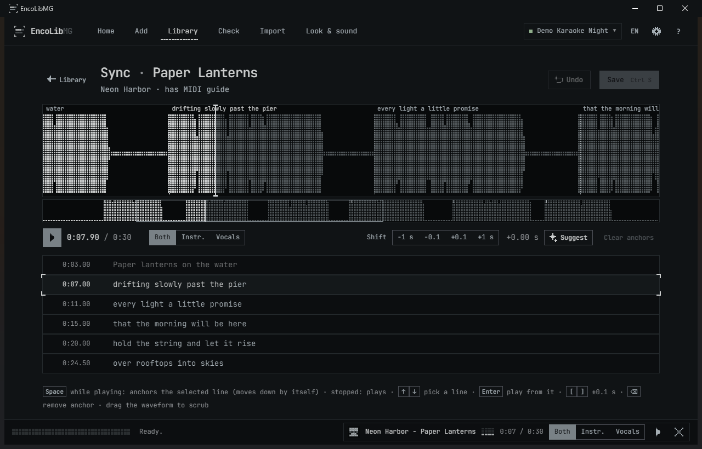
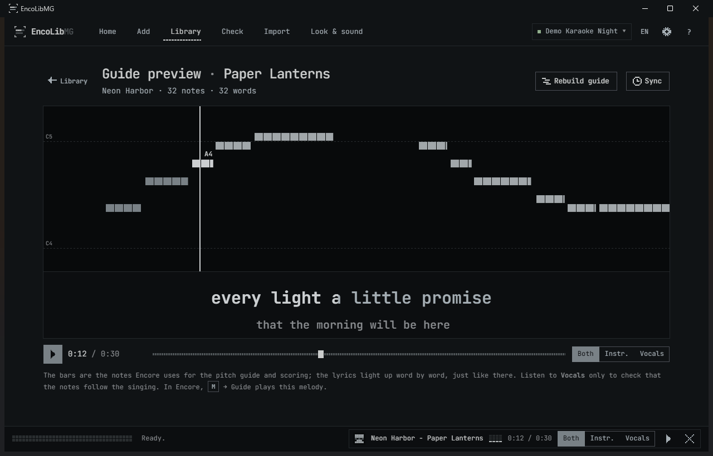
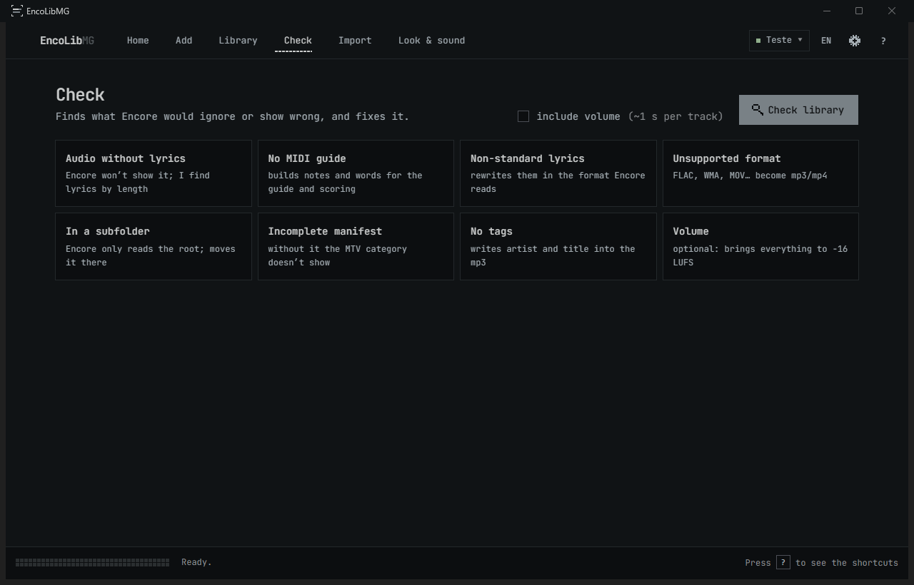

# User guide

<b>English</b> · <a href="user-guide.pt-BR.md">Português (Brasil)</a>

## Getting started
1. Double-click `EncoLibMG.bat`.
2. At the top, click the library name → **Open or create** (or `Ctrl O`). If the folder isn't a library yet,
   the app creates the `EncoreLibrary` folder with its `manifest.json`.
3. In Encore, point Setup (F2) at the library folder. Encore also finds any folder named `EncoreLibrary` on
   your drives by itself.

The app follows the Windows language (English or Brazilian Portuguese). Switch any time with the **EN/PT**
button at the top; no restart needed.

## Screens

### Home
The pixel logo, the search box and your library's numbers. Type `Artist - Song` and press `Enter`.

### Add

Pick a lyrics version and click **Download full**, or tick several and click **Add N to queue**. For each song the
app looks for audio with the same length as the lyrics (so they line up), splits the vocals from the instrumental
on your GPU, builds the Multiplex and generates the MIDI guide. The five steps light up as it goes.
No synced lyrics? **Find a karaoke video (MTV)** opens a picker with YouTube thumbnails.

### Download queue
Every song you add goes into the **queue**: the **Queue** button in the footer opens it. While the GPU works on
one song, the next one is already downloading.
- **Add a list…** (on the Add screen or in the queue) takes a pasted list (one `Artist - Song` per line), a public
  **YouTube playlist** link, or a **Spotify playlist** exported as CSV with [Exportify](https://exportify.net)
  (any CSV with artist and title columns works too). The synced lyrics are picked automatically, only when the
  artist, title (and length, for Spotify) really match.
- Each song shows where it is: waiting, finding the lyrics, downloading, waiting for the GPU, processing, ready.
- **Failed** songs say why. With no synced lyrics, **MTV** finds a karaoke video instead; **Try again** puts the
  song back in line.
- **Pause** (or Cancel in the footer) stops and keeps what was already downloaded. Adding songs starts the queue
  again.
- The queue is saved: close the app and it is still there next time, **paused** until you press **Resume**.
- When it runs out, a summary says how many came in with a guide, without one, were already there or failed.

### Library

Filters (Multiplex, with guide, no guide, MTV, MIDI, hidden), sorting, multi-select and a panel per track.
From the panel you can listen to instrumental/vocals/both, open Sync and the Guide preview, build the guide,
edit the name, add a music video, convert to Multiplex or remove.

### Sync

The vocal waveform in pixels, with every lyric line marked on it. Drag the waveform to scrub.
- **Shift everything:** ±1 s or ±0.1 s.
- **Anchors:** while the song plays, press `Space` when the selected line starts being sung.
  With two or more, the lyrics are stretched between them.
- **Suggest:** finds where the vocals start on its own.
- There's always a backup, with **Undo**. When you save, the app offers to rebuild the guide.

### Guide preview

A piano roll with the notes Encore will use for the pitch guide and scoring, and the lyrics lighting up word by
word, just like in Encore. Listen to **Vocals** only to check that the notes follow the singing.

### Check

Finds what Encore would ignore or show wrong and fixes it in one click:
audio without lyrics, tracks without a MIDI guide, non-standard lyrics, unsupported formats (FLAC, WMA, MOV…),
files in subfolders, an incomplete manifest, missing tags and, optionally, volume.

### Import
Brings in what you already have: CDs/FLAC, CDG collections, `.zip` files and `.kar`/`.mid` karaoke (the title is
read from inside the file, Japanese included). You review the names in an editable preview before importing.
The app can build the Multiplex **from your own file**, at your source's quality.

### Look & sound
- **Background videos** by category, from your PC or YouTube (only a clip of up to 5 minutes).
- **Idle images** for the screen between songs.
- The library's **intro video**.
- **Score narration**: one audio clip per score range.
- **SoundFont**: includes a download of the free GeneralUser GS.

### Settings
⚙ at the top: the library's name, description and Encore options.

## Shortcuts
| Key | Action |
|---|---|
| `/` | Search for a song |
| `1`–`6` | Home, Add, Library, Check, Import, Look & sound |
| `Space` | Play/pause · in Sync: set an anchor |
| `←` `→` | Back/forward 5 s |
| `Esc` | Close a dialog or panel, or go back |
| `Ctrl O` | Open or create a library |
| `?` | All shortcuts |

## Good to know
- **Nothing is deleted for good:** whatever is removed goes to the Recycle Bin, and every edited lyric gets a backup.
- **First song is slower:** the AI models (Demucs, CREPE, MMS, 1.6 GB) are downloaded the first time.
- **How fast is it on my PC?** See [Hardware](../README.md#hardware-what-you-need-and-what-to-expect), or run
  `python scripts/benchmark.py`.
- **Log:** `%APPDATA%\EncoLibMG\log.txt`, useful when reporting a bug.

## Identity
The **"Sung line"** mark: a karaoke line halfway through filling up, between corner brackets. The look is inspired
by [Omarchy](https://omarchy.org/), with an original design. Everything (mark, wordmark, Windows icon) is generated
from pixel grids by [scripts/brand/build.py](../scripts/brand/build.py); see the [identity page](brand/index.html).
